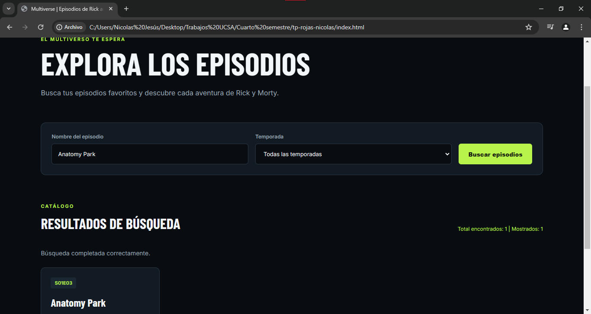

# Multiverse - Buscador de episodios

## Datos del estudiante

- **Nombre:** Nicolás Rojas
- **Modalidad:** Individual
- **Trabajo:** Trabajo Práctico de JavaScript
- **Variante:** C - Episodios
- **Último dígito de CI:** 8

## Descripción

Multiverse es una aplicación web que permite buscar episodios de Rick and Morty mediante la API REST oficial.

El usuario puede buscar por nombre y filtrar por temporada. Los resultados se muestran en tarjetas con el nombre del episodio, código, fecha de emisión y cantidad de personajes.

La aplicación utiliza Fetch API, async/await, manejo de errores y localStorage para recordar la última búsqueda.

## Tecnologías utilizadas

- HTML5
- CSS3
- JavaScript ES6+
- Fetch API
- Rick and Morty API
- GitHub Pages

## Funcionalidades

- Búsqueda por nombre.
- Filtro por temporada.
- Visualización de episodios en tarjetas.
- Mensajes de carga y errores.
- Persistencia de la última búsqueda.
- Diseño responsive.

## Captura de pantalla

## API utilizada

https://rickandmortyapi.com/api/episode

## Publicación

Pegar aquí el enlace de GitHub Pages.
